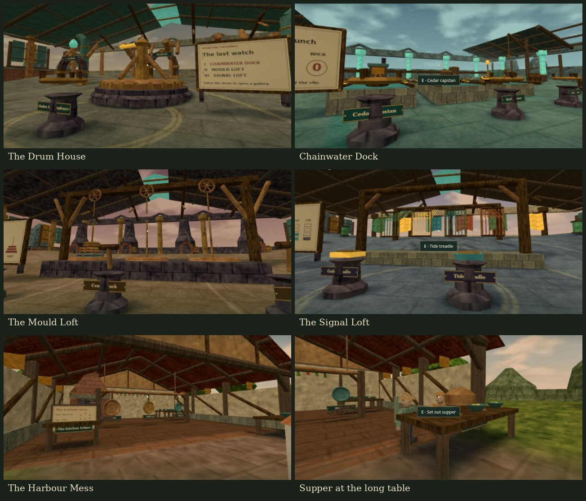
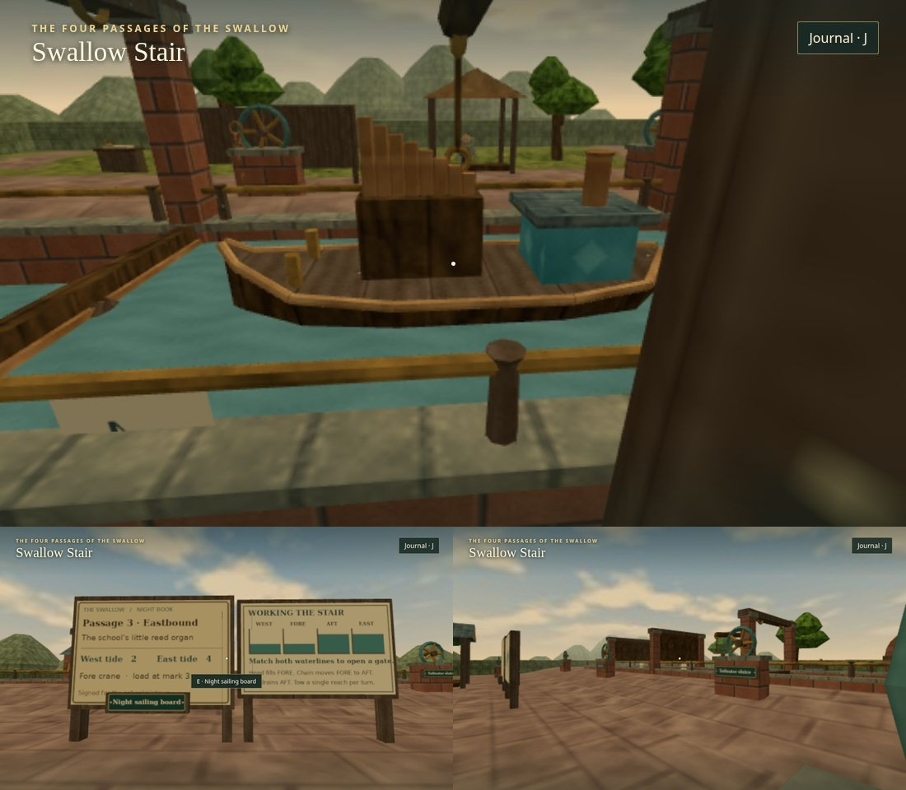
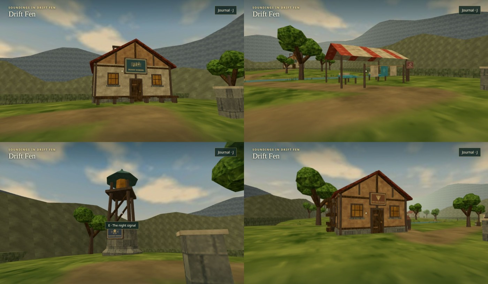

# Bellwake

Tavi made a warning bell during the flood. Her sister Ina gave it a voice for a single night. Twelve years later, the bell still keeps watch. You arrive on the first morning it fails to ring.

| Place | What to do |
| --- | --- |
| Bellmender’s Market | Visit Tavi on the path. Step through the blue courtyard door beside her stall, then return with the programme to receive her commission. The wooden sign leads to the Long Meadow in Unity. |
| Tavi’s Paper Theatre | Read the four keepsakes, set the figure, scenery and property reels and light each scene. Choose how the programme will remember Ina. |
| Saltwake Sound | Find Marn’s three witness posts. At the chart chest, steer the skiff through currents, touch the brass buoy, then reach the white mooring ring. |
| The Pilgrims’ Cut | Restore the Quince Fold, Saffron Kilns, Vellum Walk, Cairnwatch Rise and Rain Court. The road continues to the Root Choir. |
| The Root Choir | Listen to Moss. Ring the three individually pitched bells in the order described by the forest round. |
| The Rimeway Post | Recover the lost post. Slide the mail sled through the cache and stop it at the landing. |
| Three houses of Sillwater | Meet Ada at ebb. Consult the field map in your witness book, visit the survey stands at both tides and reconstruct the three addresses in the map office. |
| Reedwater Lock | Ask Fen which channel saved the village. Each wheel changes the pair of sluices marked on its station. |
| Drift Fen and Swallow Stair | Use Willa’s sounding fork to find four missing loads, then work Fen’s double lock to return them. |
| Glasscut Gallery | Read Jass’s casting records. Move the bronze miner behind the gem cart and push it onto the white socket. |
| The Cinder Lens | Trace the amber ray from the kiln. Turn the three mirrors and catch the light in the casting cup. |
| The Glass Rookery | Meet Orla. Learn the weir and lantern signals, then whistle three different pilot birds along their flight paths. |
| The Lower Works | Sign the night roll below the rookery. Explore the three guild wings in any order, listen to the craftspeople and take their work to the great resonator. |
| Wrenfall Head | The resonator lift emerges on the Pilots’ Coast. Help Mirren bring the flood book through the reef. |
| The Countertide Engine | At the drum house, route the headrace to the chain dock, mould loft and signal loft. Finish Elin’s last dispatches to open the ascent. |
| The Still Belfry | Speak to the keeper to start the encounter. Reach and activate the called seal before the toll. After three misses, the keeper lets you try again. |
| The morning market | Choose who carries the watch. Both choices change the market and open a final conversation. |

The market, Root Choir, Reedwater, Cinder Lens and belfry each hold a witness leaf. Each of the three witness-road districts has nine dispatches and three witness posts. The compass keys on the chart chest take a trigger or E. The navigator offers a hint, the rewind lever resets the current chart, and the stamping desk certifies a delivery. Current chart positions and sealed dispatches survive a reload. A chapter, puzzle action or recovered leaf updates the checkpoint. Unity stores the journey in PlayerPrefs. The browser edition saves to local storage for its current origin. The epilogue arch takes two deliberate activations to start a fresh journey.

The witness book shows active playtime. Loading, the open journal and unfocused play are excluded. The clock starts with this update for existing checkpoints. Players already past a new district retain their place in the story.

The 32-place Drift Fen route reached its first ending in 36 minutes 36 seconds of active play with known solutions. The Glass Rookery extends that route. The design target is 25–30 hours for a first-time player. A human completion time has yet to be measured. [Playthrough details](validation.md)

## Tavi’s Paper Theatre

The sisters’ theatre stands in the courtyard behind the blue ticket door. Each scene takes its evidence from an object in the yard. The three reels place a person, a setting and a prop onstage. A correct performance lights another lamp on the marquee. The reels and lit lamps survive a checkpoint reload or a trip back to the market. On the final programme, credit Ina as a bellmender or a lock runner. Tavi recalls your choice in both endings.

Existing market and epilogue saves can visit through the same door. [Courtyard and puppet-stage photographs](paper-theatre.jpg)

## The Pilgrims’ Cut

Mara keeps the orchard shelter on the road out of Saltwake. The flood survey erased a public right of way. An old tree, the tilemakers’ mile and the evidence of the families who used the road can restore it. Each ward has a survey board. Open your witness book to see the same survey with your location marked in red. Each square measures eight metres.

At the grafting bench, take Mara’s brass waywren. Press Q or squeeze the left grip to send it along the lanes toward the next available job. It waits after four junctions. You can call it again wherever you stand. Work yards double as shelter checkpoints. After restoring a ward, ring the return line at the final work yard to reach the entrance. The other bell carries you to the open wicket. Later wards have a return path to the previous one.

On the final morning, an illuminated book is fastened to the west pier of the market arch. Each household has sent a letter. Turn the pages with E or a trigger to learn how your decision at the belfry changed their lives. [The public road book in Bellmarket](public-road-book.jpg)

[Five work yards and the orchard survey as they appear in play](pilgrims-cut.jpg)

## Three houses of Sillwater

The Sillwater packet counter is to your right when you arrive in Bellmarket. Ring its handbell to visit the parish at any point in the market story, including either ending. Reedwater Lock also sells return tickets. The northeast towpath takes you back to the district you came from. If you seal Ada’s map on an early visit, the Rimeway Post takes you straight to Reedwater later. [The ticket counter in Bellmarket](packet-counter.jpg)

The river changes the route across the parish when you pull either tide bell. At ebb, take the oyster causeway. At flood, use the ferry bridge. The east crossing stays open. Your field sheet shows the instruments and your position at the current tide. Two copies of the survey also hang beside the landings.

Stand beside a brass telescope and press E or a trigger. Follow its barrel to the landmark named in the prompt. Look at the landmark itself and press again to record its bearing. You can begin on either shore or revisit the office between sightings.

In the map office, the registrar has a folio for each lost house. Its red thread follows the ebb bearing and its blue thread follows the flood bearing. Turn the four carriage wheels to move the brass pin to their intersection. Stamp each address and have the title sealed. The signed ledger travels with you to Reedwater and into either ending. [In-game views of the parish and map office](sillwater.jpg)

## The Glass Rookery

Leave the Cinder Lens through the casting gate. Orla is waiting at the lodge with a carved whistle. Her flight book shows a different chart for each bird. A solid blue line means running water, and a broken ochre line means quiet water. Read the numbered stone at the next perch, stand within calling distance and press Q or squeeze the left grip. You can hear the bird answer before it lands.

Pip, the little grebe, carries the first tube. Slate, a grey heron, follows a different watercourse. For Ash, the copper tern, match the destination’s shutter letter on the lantern console as well. Once a bird reaches its home perch, return to Orla’s sending desk. The last tube holds something Ina made for Tavi. Open the witness book to unfold her charcoal portrait. On Quest, turn the pages with a trigger. The letter stays with you through either ending.

[Pip, Slate, Ash and the glasshouse as they appear in play](glass-rookery.jpg)

## Beneath the village

In the Court of Three Trades, stand by the night roll and look toward the doors. West leads to the waterworks, east to the foundry and north to the lampmakers. Each wing has two chambers. Follow their service stairs to move between trades. A return to the court preserves your work at every machine.

At the intake, the narrow and wide tanks measure three and five. Use the gauges while drawing, transferring and emptying water. The archive records what people heard when the flood arrived. In the weigh house, the old western pan already carries a burden. The casting bed beyond it holds a cold mould. In the lampworks, follow both beams and read the bearings beside the orrery windows. When all three guilds have entrusted you with their work, fit the artifacts in the rotunda, play the testimony and hear Ina before taking the final lift.

**The Fourth Hand** is optional. Ask Nema in the court whose name was left off the night roll. Fen knows the rope knot, Orrel kept the pay leaf and Brannic kept a spare wage. Ossa can cast the three proofs into a nameplate. Bring it to Nema. On your final return to Bellmarket you can read it at the way arch in either ending.

## The Pilots’ Coast

Mirren waits outside the chart shelter. The large survey beside her shows where the paths meet. The western chapel records the water level the cutter needs. At Split Stone, use the sighting rail, face the bell on the distant stack and press E or a trigger to record the bearing. The northern lookout has a glass trained on a second mark. You can walk a few steps around each instrument for a clearer view. The journal records each observation.

At the eastern mast, pull the halyards in the order the pilots recorded. The flags above you show how many signals the cutter has acknowledged. Haul the harbour capstan, watch the Linnet round the reef, then meet her skipper at the landing to reach the Countertide Engine. Her signed flood book stays in your journal. At the morning market, the harbour crew has a different part in each ending.

[Four views from the headland](wrenfall.jpg)

## The Countertide Engine

In the Drum House, the arrow on the spindle points to the gallery it serves. Index the headrace at the centre, then approach the illuminated arch. The three workshops can be completed in any order. Each control saves its mechanism and a nearby checkpoint.

- At **Chainwater Dock**, each capstan advances two ferries around three berths. Read the dispatch card in cedar, rush, wick order. When all three hulls match the order, sound the gong.
- In **the Mould Loft**, touch a rack to hook its top collar and another rack to lower it. A narrow collar can sit on a wider one. Pull the testing chain when the complete assembly is on the rack pictured on the card.
- In **the Signal Loft**, read each sampler from the top. The filled squares identify raised warps. Set the treadles and beat the shuttle. Each treadle stays where you left it for the next row. The journal also names the required threads.

When the four cargoes, three moulds and four signal flags are entered, return to the drum house and take the keeper’s ascent.

## The Supper Call

The mess stair on the east side of the Drum House leads to Iona’s kitchen. Listen to Nell’s dented lunch tin, Ara’s measuring cups and Wen’s embroidered tea cloth in their respective workshops. Each plays a three-note phrase and adds the pitches to your witness book. Play the phrases on the three hanging pans in the order Iona remembers. The shelf above the pans fills a bowl for every completed phrase. You can leave mid-song and pick it up when you return.

Set out supper to bring the three night workers to the table. Look for their contribution in the market after either ending.



## Controls

| Action | Quest controllers | Unity desktop | Browser desktop |
| --- | --- | --- | --- |
| Move and jump | Plant a palm on a surface, push and release | WASD and Space | WASD and Space, Shift to run |
| Look or turn | Head tracking and right-stick snap turn | Middle click to capture the mouse, Escape to release | Drag or use the arrow keys, double click to capture the mouse |
| Speak, ring or turn | Face a nearby station and press a trigger. The Root Choir bells, belfry seals and kitchen pans also sound when struck with either tracked palm. Withdraw your hand between notes. | E | E |
| Open or close the witness book | A or X | J | J |
| Call Mara’s waywren in the five wards | Left grip | Q | Q |
| Read a collected leaf | With the book open, a trigger turns the page | E with the book open | Collected leaves appear in the book |

Crouching makes the ground easier to reach with the palms. The journal pauses the final encounter’s countdown.

## Direct browser play

Double-click `Play/Bellwake.html` in the downloaded project or extract the standalone play ZIP and open its HTML file. Geometry, textures, music and the JavaScript player are embedded. The browser edition includes the entire Bellwake campaign and the optional harbour kitchen. The large meadow and Mossbell Village are accessible through the Unity edition.

For Quest Browser, serve the entire `Play` directory over HTTPS and open `index.html` for on-demand chapter downloads and choose **Enter VR**. With a USB-connected developer-mode Quest, a local alternative uses Python and Android platform tools on the PC. From the repository root, run these in separate terminals.

```shell
py -m http.server 8090 --bind 127.0.0.1 --directory Play
```

```shell
adb reverse tcp:8090 tcp:8090
```

Open `http://localhost:8090/index.html` in Quest Browser while USB forwarding is active. A compatible browser offers **Enter VR** on the opening screen.

## Editable art and sound

The packed Blender sources in `Blender/Bellwake` contain the twenty-eight campaign sets, the meadow trail sign, the runner’s arms, the two individually modeled hands, the meadow outcrop and the mountain gate. The campaign reuses characters and props from the supplied Wizzard Themed Library, with articulated head and arm pivots on speakers. The cottages use the existing Mossbell Blender artwork. The court geometry, interactive mechanisms, bell tower, escarpments, banners, floor paintings, skies and score were authored for this campaign.

Ground and path share one continuous mesh. Lighting includes baked ground contact shadows. Buildings, clothing, brass and foliage use their own paintings and UV atlases. The Unity player loads one campaign room at a time and adds mesh colliders to the terrain, visible static set, rim and solid cores.

After editing the source, regenerate the FBX and GLB for that room from the project root. Blender 4.3.2 was used for the release.

```sh
blender -b --python-exit-code 1 --python Tools/bellwake/export.py -- RootChoir
```

The procedural authoring scripts are in `Tools/bellwake`. Rebuilding from those scripts uses the original Wizzard Themed Library folder. Editing and exporting the packed Blender scenes works independently of that download. The PNG paintings are under `Assets/Resources/Bellwake/Textures`. The original music loops and four bell cues are under `Assets/Resources/Bellwake/Audio`.

## Rebuild the portable edition

Run the packed-scene exporter without a room argument to prepare all GLBs. Compile `Tools/bellwake/StoryGraph.cs` together with `Assets/Scripts/BellwakeJourney.cs` with `Assets/Scripts/BellwakePassage.cs` and `Assets/Scripts/BellwakeWorks.cs` using Mono’s C# compiler and `System.Web.Extensions`. The resulting executable accepts the destination of the JSON story table. It checks that both endings are reachable from every unfinished state before writing the file.

```sh
blender -b --python-exit-code 1 --python Tools/bellwake/export.py
mcs -r:System.Web.Extensions -out:/tmp/BellwakeStory.exe Tools/bellwake/StoryGraph.cs Assets/Scripts/BellwakeJourney.cs Assets/Scripts/BellwakePassage.cs Assets/Scripts/BellwakeWorks.cs
mono /tmp/BellwakeStory.exe Tools/bellwake/.web-assets/story.json
npm ci --prefix Tools/bellwake/web
python Tools/bellwake/web/package.py Play/Bellwake.html
```

The browser uses Three.js under the MIT license, included in the HTML. Meta’s IWER is a development-only dependency for the emulated headset checks.

## Swallow Stair

After solving Reedwater’s three sluices, go through its arch and take the watch from Fen. Read the sailing chit for the prevailing tides, the designated crane and its loading mark. Open the headwater feed to raise the fore chamber. The bucket chain transfers one mark from fore to aft. The tail sluice drains the aft chamber. A gate lifts when the water on both sides matches. Haul the boat one reach east or west at a time, use the crane, then stamp the receipt at the opposite landing. All four jobs share the same water and boat. On the fourth crossing, the night-watch tin reveals Ina’s slip. File it by name or by her swallow mark before leaving for Glasscut.



## Drift Fen

For an immediate visit from Bellmarket, take the red Drift Fen fare beside the Sillwater counter. To get back, leave the fen for Swallow Stair and use its northeast towpath. You can also enter during the main story. Fen’s western footpath leads to the damaged settlements along Alder Stream. Willa keeps the sounding fork at the ferry. Ring it with Q on desktop or the left grip in VR. Its pitch and Willa’s bearing tell you when to turn and when you are close. Once the fork gives a clear reply, look down and lift the uncovered object with E or a trigger. The field sheet in your journal marks both fords and all four settlements.

You can recover the metal pieces in any order. At the school, read the names behind the missing bass reed. At the old bakehouse, look for Brindle’s tally. Pella’s clasp and the watchman’s key lead to the two remaining loads. Each discovery survives leaving the fen, closing the game or returning to the lock. The heavy cargo travels by crane.


