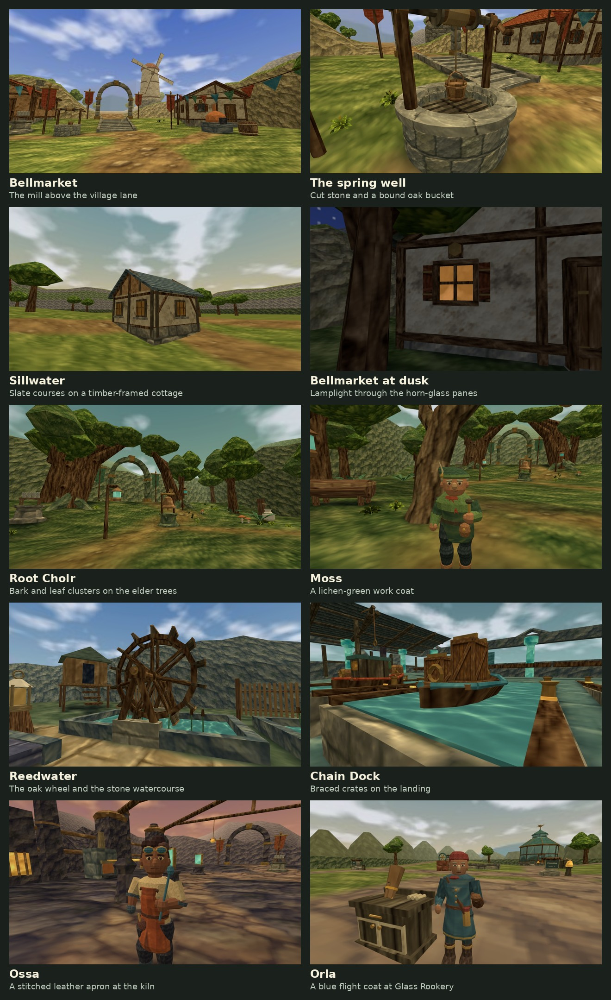

# Bellwake’s image textures

[Download all ten gameplay screenshots at 1280 × 720](painted-gameplay.zip) · [Compare three views with the previous release](image-texture-comparison.jpg)

Bellmarket’s well shows the approach at arm’s length. Two staggered courses of stone wrap around the wall. The coping uses a separate strip of chipped stone that bends around the rim. An oak-stave painting wraps around the bucket underneath its metal hoops. The bucket and the dock casks share part of the same small texture sheet.

| Look here | What to look for |
| --- | --- |
| Bellmarket | The grain follows each beam and diagonal brace. Shutters, limewash, roof tiles and horn-glass panes have separate finishes. Return at dusk to see the light behind the glass. |
| Root Choir and Rowan Hollow | The crowns have painted leaf clusters with dark pockets between them. Fern and sorrel silhouettes sit on crossed planes at the edge of the paths. |
| Reedwater | Cattails at the bank, moving water and the waterwheel’s oak frame each have their own surface. |
| Chain Dock | The bracing fits each crate face. The cask lid, staves and hoops read separately when you walk around one. |
| Glass Rookery, Root Choir, Cinder Lens and Reedwater | Orla, Moss, Ossa and Fen wear individually painted garments. Closures, stitching and pockets follow the torso around to the back. |

The artwork is original to Bellwake. Most repeating surfaces use 64 × 64 images. Up close, three-point filtering preserves the shape of the painted texels. At a distance, mipmaps soften fine details such as leaf tips and the lips of roof tiles.

## Adding a house or prop

In Unity, choose **Wizzard → Create retro material library**. Assign **HousePlaster**, **Wood**, **RoofTiles**, **Bark** or another material to each matching part. The world-space materials also work on meshes without UVs. For a unique door, sign or clothing detail, give the mesh UVs and assign its own painted image.

The small source paintings and their colour grades are editable. The Blender scenes include packed copies of the artwork. The surface check compares images in the playable models with the Unity project and checks the margins around the plants and prop panels.

[Source paintings](../../Tools/bellwake/surface_sources) · [Colour grades and sheet layouts](../../Tools/bellwake/surface_paint.py) · [Surface validation](../../Tools/bellwake/check_surface_art.py)

## Verification

All 850 embedded image references in the 46 playable models match the corresponding Unity PNGs. They use 206 distinct images. The four planted districts each submit their new vegetation in one batch. All 43 packed collision files match the preceding release byte for byte. The Unity FBX audit checked 1,045,338 ground positions and cast 234,920 rays along district boundaries.

Across the room models, the largest increase in decoded colour texture storage is 294 KiB in Bellmarket, rounded up. This estimate includes full RGBA8 mip chains. Each of the four plant types kept a visible silhouette at 18 metres in a 256-pixel WebGL test. Headset frame time still needs measurement on a physical Quest.

Three streaming laps made 141 district entries. After each move, the previous scene was collectible, and each return to the same district reproduced its GPU resource counts. Bellmarket peaked at 41 resident textures in that test, up from 39. Five paired standing views added one or two median draw calls. The signed Android installation served all 173 packaged files with their expected contents.
