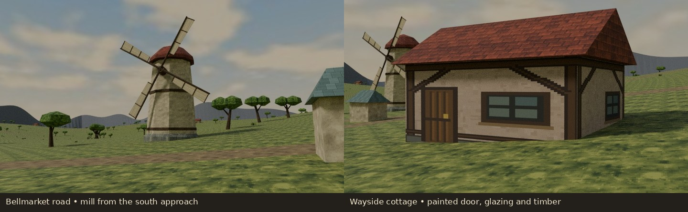

# Bellwake on standalone Quest

The Unity entry scene is `Assets/Scenes/Meadow.unity`. On a new save the C# bootstrap starts in Bellmarket with Tavi. Plant a tracked palm against a solid surface, move your arm and release to launch. Snap-turn with the right stick. Take the trail sign toward Long Meadow to enter the highroad, or reach Paper Court through the story.

## Building on Windows

Close Unity, run `git pull wizzard main` in the project directory and double-click `Build-Quest.cmd`. The script uses Unity 2022.3.20f1 with Android Build Support, SDK/NDK, OpenJDK and an activated editor license. A successful build writes `Wizzard-Bellwake-Quest.apk` beside the script. The build checks for ARM64 Unity, IL2CPP and OpenXR libraries and Unity player data. The build log is `Builds/Quest-build.log`. The old WebXR launcher has its own name in `Play/`.

To measure a headset walk, run `Build-Quest.cmd profile`. This produces `Wizzard-Bellwake-Quest-Profile.apk` alongside the release build. Install it with `adb install -r Wizzard-Bellwake-Quest-Profile.apk`, then run `adb logcat -s Unity`. Walk from the coast to the belfry and return along the same road. Every 360 Unity frames on the highroad the log reports median, 95th percentile and worst frame interval, active cells, total loads and retirements, completed memory sweeps and Unity allocated memory. Compare revisits at the same gate to see whether residency and memory settle. At 72 Hz one display refresh takes about 13.9 ms. Compositor timing can be checked separately on the headset.

## Crossing the watershed

The highroad is a single rolling terrain laid out across a 1,440 × 1,200 m survey. Its 42 district gates and Long Meadow entrance connect through 72 road segments totaling 12.68 km. That number sums every segment once. A single playthrough takes its own route. Long Meadow is a separate 2,048 m square landscape. The original playthrough clock predates this field.

The ground and cliff colliders stay resident. Roads change the surface material on the ground mesh, so there is one floor at the grass border. A near-vertical course joins the foot of each perimeter cliff to the ground. Falling back into the world returns the player to their latest teleport. Road saves check the ground under the player's tracked position.

Scenery loads around the headset within 365 m. Past 425 m, its renderers and colliders leave the scene together. The gap between these distances prevents flicker when crossing a loading boundary. On long walks the game batches the global Unity memory sweep after eight cell retirements, or sweeps during a pause after a smaller retirement. District changes release the field. In Play mode, **Wizzard → Validate highroad streaming in Play mode** runs an isolated crossing and return to check destruction and reloading of the actual Unity colliders.

## Modeling decisions from the footage and ROM

| Reference observation | How it changes the native artwork |
| --- | --- |
| The field bush uses nine local vertices and three triangles. Transparent leaf shapes carry the silhouette. | Sorrel uses three crossed image planes, six triangles and a painted alpha cutout. It has no collider. The neighboring forked trees have solid trunks for the player's palms. |
| The PAL Saria head has separate eye and mouth paint. At 00:54:01 the fringe still reads in profile. At 02:56:06 the brow, collar and eyes remain readable against green. | Tavi has a swept, closed fringe, tapered ears, painted green eyes and a copper pin. Her face and clothes share a 128 × 128 atlas. She appears in the opening market and the paper theatre. |
| At 01:44:03 a stair and gate frame the next destination. In the village references, the windmill identifies a terrace well before its windows become visible. | Each field region carries a distinct distant silhouette. At eye level, the market mill's four broad sails stand above the houses. At conversation distance the cottage has legible braces, glazed panes and a plank door painted onto each 64 × 64 facade panel. |
| The PAL extract contains 35 JPEG backdrops. Architectural detail can live in an image. Vertical depth matters when the player can lean around an object. | Cottage walls use painted panels, with a separate side-wall image. Roof, wall and foundation still enclose a solid climbing surface. Eleven regional model atlases have material-specific swatches for timber, masonry, cloth and metal. The district Blender files carry the same packed paints that Unity loads. |

The walkthrough archive contains 1,017 timestamped 854 × 480 stills across 16:56:00 of footage, with a CSV index. The private Blender studies put the PAL field bush, Saria's head and her 15 drawn limbs in an authored animation pose beside the original Bellwake models. The game ships the new Bellwake art. [Walkthrough observations and seek times](ocarina-walkthrough-study.md)

For another comparison, extract the supplied PAL 1.1 ROM with ZeldaRET's extractor. From the project, run `python Tools/reference/model_study.py <extracted-assets> <workbench>`. Keep both folders together so the relative MTL texture paths work. The converter scanned 6,837 draw fragments and wrote 6,774 local OBJ fragments containing 258,496 statically resolvable triangles. Another 2,635 triangle commands depend on unresolved vertex data. A fragment can be a hand, part of a room or a prop. The original engine can assemble many fragments for one model and change matrices, palettes or eye textures during play. The private model catalog has 106 numbered contact sheets. Its CSV maps each of the 6,774 thumbnails to a Blender-importable mesh. To regenerate it, run `python Tools/reference/mesh_catalog.py <workbench> <catalog-folder>`. Thumbnails use the locally bound textures and a neutral swatch for unresolved dynamic materials. The complete decoded banks supply the runtime context. `Tools/reference/pose_study.py` also reconstructs the near-detail standard limb hierarchy from compatible skeleton and animation records for Blender inspection. [ZeldaRET extractor](https://github.com/zeldaret/oot)

## Verification

Blender reimported the shipping FBXs. The 42 districts passed 1,045,338 ground probes and 234,920 perimeter rays. The audit found approaches to all 461 interactive stations. Separate field checks traversed all 72 roads and tested the ground, overhead clearance and side clearance at 37,761 sample positions. Another 1,530 outward-facing probes from inside the perimeter checked the cliff seam at ankle, waist and head height. A traversal of the cell-distance policy peaked at 18 of 42 cells. An independent C# harness also drove the production field coroutine through 84 gate visits using simulated Unity resource requests. It counted 328 loads, 320 retirements and eight cells resident on return. It checked two consecutive 360-frame field logging windows and the return to ordinary room logging. These checks measure residency policy and logging behavior. Actual headset frame time, memory use and completion time still require the built player.

The C# rules reached both endings from every unfinished base-story state, exercised 18,310 machinery transitions and checked four directions at each of 10,414 passage positions. Runtime and editor scripts compiled against the Unity 2022.3.20f1 managed assemblies. The Linux Android build stopped at Unity license activation before asset import, Play mode or APK export.
