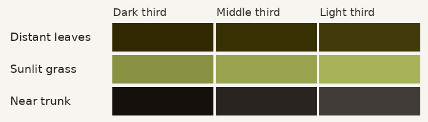

# What Bellwake can learn from Ocarina of Time

Three shots give a modeler a good starting point. At **01:25:04**, young Zelda's ears extend well beyond her head covering. You can read her expression because her eyes and brows have clear shapes on a quiet face. At **01:44:03**, a pale flight of stairs leads straight to a darker gate, and a guard at the top tells you its scale. At **11:33:05**, you can follow Link out of the water, up a ladder and onto a platform in four seconds. Rungs, waterline, ledge and door stay visible through the move. Bellwake needs all three kinds of visual information. The player should recognize a character, see where to go, and know where a hand or foot will land.

## Where to look in the recording

Times are hours, minutes and seconds from the start of the supplied MP4. Each entry points to a shot you can find again.

| Seek to | Visible detail | Use in Bellwake |
| --- | --- | --- |
| 00:07:03 · 00:08:05 · 00:13:04 | An overhead home interior has a circular pale rug, planks and a few objects at its edges. Outside, water and a short bridge divide the clearing. A mossy ledge has a light top and a dark band at its lip. | Give each small home one recognizable center. Carry the turf color up to the brink of a ledge and establish depth on its side. |
| 00:20:04 · 00:32:03 · 00:45:02 | Green-clothed villagers stand out against brown bark. A warm ladder breaks up a mossy wall. In the boss room a conspicuous eye is visible in shadow. | Spend the strongest local contrast on the face, handhold or threat the player needs to find. |
| 00:54:01 · 00:56:05 · 00:58:04 | Saria's projecting forelock reads in profile. The owl's brow tufts cut into a pale sky. In the night field the ridgeline and white fairy remain visible after the grass loses detail. | Check hair and brows against the sky. Test the road at night with the terrain texture nearly indistinct. |
| 01:03:02 · 01:22:03 · 01:25:04 · 01:29:02 | Shop stock gathers behind a counter. Hedges define the castle route from above. The courtyard conversation cuts from faces in daylight to yellow flowers. A translucent text panel moves from the upper part of the picture to the lower part. | Stage the speaker against a quiet surface. Give a shop its identity through its counter stock. Keep the VR reader's view steady through a change of speaker. |
| 01:44:03 · 02:02:20 · 02:24:24 | Low stone walls flank the stair to a gate. A musical staff is visible on a pale blue surface. At the ranch a horse stands free of the dark fence line. | Use an architectural sightline for a destination, a graphic mark for an instruction, and clear ground around an actor that needs to be approached. |
| 02:40:06 · 02:56:06 · 03:23:03 | A Goron's heavy shoulder and spotted back occupy most of a conversation shot. Saria's bright fringe, wide eyes and pointed collar create a very different outline. Parallel rails cut a clear horizontal line across the cavern ledge. | Design the shoulders, head and collar together. Carry rails far enough around a bend to signal the edge. |
| 03:44:02 · 03:55:05 · 04:16:03 · 04:44:02 | Rope posts follow a rocky descent. The Great Fairy has a sweeping red hair shape. At the water's edge a head breaks the surface. On the lake bridge, rails converge on a perched owl above the far steps. | Use the spacing of posts and deck boards to show distance. Place an important encounter where the approach already directs the eye. |
| 05:03:06 · 05:20:05 · 05:31:01 | Jabu-Jabu's entrance frames the route with teeth. Inside, reds and folded organic walls surround the raised surfaces. In dialogue Ruto's broad blue head reads immediately against Link's green cap. | Give a district a characteristic surface treatment and entrance shape. Retain a distinctive head profile on a companion small enough to carry. |
| 05:57:04 · 06:05:01 · 06:13:05 · 06:42:01 | The mask shop frames its counter with drapes. Adult Link in side view has pointed locks overlapping the cheek and a prominent nose. Two villagers share a plain domestic interior. The rancher's brows and moustache project far beyond the middle of his face. | Give principal NPCs one feature visible in profile. Give background residents different postures, clothing masses and positions in the room. |
| 06:38:02 · 06:44:00 · 07:33:05 · 07:38:05 | A rider clears a fence whose rails remain visible during approach. Distant trees keep an open trunk and a thin canopy. Four colored flames organize a temple chamber. Repeated framed pictures break up the walls of a circular arena. | Keep an obstacle readable in motion. Repeat a shape to define the room, then change one property when the room state changes. |
| 07:55:04 · 08:38:06 · 08:50:06 | Bright steps isolate a speaker in the dark temple. Low sun reduces the ranch fence to a thin dark rhythm. A mounted night view switches into a bow sightline along a wall. | Test a fence and gate against daylight, sunset and night. Show a VR tool's aim through its own form while keeping head tracking live. |
| 09:17:04 · 09:33:03 · 09:54:01 · 09:56:01 | A Goron's yellow face and broad shoulders fill a narrow, dark alcove. A small key is isolated against the room on pickup. The fire arena is a dark disk with red openings. The dragon's bright mane separates it from the red background. | Give collectibles a clear inspection pose. Separate a moving threat from a hazard with brightness and outline, even when both use the same color family. |
| 10:15:02 · 10:26:02 · 10:45:02 | Frozen Zora's Domain has pale floors and a bright cascade. In the cavern, violet and red ice retain distinct facets. In the Water Temple an ornament band runs horizontally above the water. | Give wet stone, ice and water different edge shapes. Continue the wall band around corners so a player can judge current height. |
| 11:10:06 · 11:33:05 · 11:46:05 | A single tree, island and far doorway interrupt the pale horizon of the Dark Link room. In the temple a ladder crosses the waterline. At the fishing pond a curving pale bank makes the shallow edge legible. | One tree can carry an entire room. Let changes in depth be visible at an edge, especially where the player needs to climb out. |
| 12:05:02 · 12:21:02 · 12:30:02 | Inside the windmill, the musician's tall instrument and hat separate his outline from the curving wall. The well uses narrow corridors, bars and scattered small objects. The frog group shares one log, with large eyes, color changes and short individual movements. | Set groups on a shared base. Reuse a body plan, then vary posture, timing and accent color so each member can be picked out. |
| 12:48:05 · 13:10:04 · 13:33:03 · 13:56:00 | A red detail interrupts the gray-green Shadow Temple. A pool of cyan light locates Link in the dark boss arena. A red-clad Gerudo fighter separates from gray masonry. In the wasteland a small platform and guide remain visible as the horizon disappears. | In darkness or fog, preserve the next actionable cue. Leave a clear floor around a gesture or encounter. |
| 14:18:03 · 14:33:03 · 14:56:05 · 14:59:05 | Two large stone forms frame a sandy route. Pale marked blocks read against brown walls. Later, an isolated field tree is recognizable at riding distance, and a dark fortress door has a large pale crescent. | Use a tall shape for an approach and a broad graphic for the exact entrance. Size the mark to survive a distant view. |
| 15:15:05 · 15:36:05 · 15:40:05 · 15:57:06 | Several carpenters are readable as a group in the tent. A bright circular mirror stands out on a patterned wall. An armored figure has layered shoulders and long weapon blades. Adult Zelda's shoulder pieces and swept hair remain distinct against gray stone. | Spend geometry on pieces that overlap in profile. Use patterns for the surface detail inside those outlines. Leave the background behind the face quiet. |
| 16:06:03 · 16:27:03 · 16:31:02 · 16:43:02 | Icy blocks recall an earlier region. Torches bracket the approach through the tower. Ganondorf's cape silhouettes against warm windows. Later, Ganon's pale blades flash against a much darker body. | Reintroduce a familiar material on the final ascent. Check a boss's identifying shapes in its dimmest pose as well as its reveal. |
| 16:48:01 · 16:50:01 · 16:53:01 · 16:55:59 | The last conversation places two profiles against the sky. Credit shots revisit known locations and characters. The final frame holds a sepia courtyard with “The End.” | Let the ending revisit a place the player learned on foot. An original change of light, posture or occupant can carry the payoff. |

## Applying the references in Blender and on Quest

**Faces and hands.** For an original character such as Tavi, block the head, then compare front, three-quarter and profile views at conversation distance. The shot at 06:05:01 shows why the forelock needs actual depth. The front view at 01:25:04 shows how much expression the painted eye and eyebrow shapes can carry. For Tavi, keep the identifiable swept fringe, apron and working hands. Close the underside of each projecting lock, cuff and collar. Pose the wrist and shoulder at both ends of their travel and inspect them from a crouched player's eye height. The painted journal portrait and the world model should still read as the same person. [Tavi's model and journal portrait](tavi-and-ina.jpg)

**Trees, grass and props.** For a family of seven trees, vary trunk lean, fork height, crown width and the gaps between leaf masses. A squat forked shade tree and a tall narrow wayside tree should differ even when viewed as solid silhouettes. Within each crown, paint irregular neighboring patches of olive, mid-green and a smaller yellow-green highlight. Turn the tree around to catch bands aligned with UV rows. Check it in shade as well as sun so the highlights retain texture. Reserve vertical grain for bark and directional strokes for sawn boards. Give turf a broader mottled pattern than either one. At 06:44:00 you can see between the field trees from horseback. The clearing's layout matters as much as any one tree model. [The current Rowan Hollow clearing](rowan-hollow.jpg)

**A color check for the tree-brightness question.** In the daylight riding shot at 06:44:00, the distant canopy reads as dark olive against a much lighter pasture. The same frame still has visible variation inside the grass and the bark. These are display RGB samples from this particular video frame. They include the lighting and video compression.

| Part of the image | Dark third | Middle third | Light third |
| --- | --- | --- | --- |
| Distant leaves | `#2F2800` | `#373003` | `#413A0A` |
| Sunlit grass | `#899142` | `#99A44E` | `#A6B358` |
| Near trunk | `#15100B` | `#2A2420` | `#413B37` |

The samples use the median RGB in each brightness third of three patches. On the 854 × 480 frame, the top-left and bottom-right crop bounds are (173,131)–(223,160) for leaves, (357,354)–(451,453) for grass, and (689,213)–(720,293) for bark, with the right and bottom bounds exclusive. For Bellwake's brighter green crowns, start by lifting just the sun-facing clumps. Keep shaded pockets at branch forks. Compare the result beside the turf at walking distance before changing the whole material again.

**Ground, paths and buildings.** At 00:13:04, the dark lip makes a shallow ledge legible even with a soft texture. At 01:44:03 the stair is broad enough to read from its foot and its edges meet solid retaining walls. For Bellwake, build a branching dirt path into the same ground surface as the grass. Give a junction one set of shared border vertices and consistent world-scale UVs. This removes the competing surfaces that make two joined path strips appear to flicker. Give foundations thickness on sloped ground. Test the downhill corner, approach a doorway from both sides, and look back along each wall from crouch height. Feet, posts and sills need a visible contact point even with shadows disabled. [Bellwake's highroad layout](highroad.md)

**Dialogue and player control.** At 01:29:02 the courtyard stays in daylight and the panel sits above the faces. About two seconds later the shot cuts to flowers and the next panel sits below. At 04:44:02 the bridge approach cuts to a low view of the owl as conversation begins. Bellwake's requested surrounding dim can provide that change of focus in VR. Keep the eyes and hands of the speaker visible, freeze locomotion and preserve physical head turns. Check that advancing the final line releases locomotion once, with no stored hand impulse kicking the player forward. The original's camera cuts are useful staging references for a player who chooses where to look.

**Travel and performance.** At 11:33:05 the uninterrupted ladder exit explains the spatial relationship between two levels. At 05:37:43 the river title identifies a location change. For the connected highroad, keep the destination landmark visible as the player walks to the gate and preserve the approach direction when they enter. Test the return walk too. For Quest, measure the slowest transition frame and the 95th-percentile walking frame time on the headset. After repeated out-and-back trips, count active collision trees, worlds and textures to catch resources accumulating. The recording shows what travel looks like. Bellwake's own tests supply the timing and resource evidence. [Existing release measurements and hardware coverage](validation.md)

## Four details that show up in motion

- **A jump has a visible landing.** From 06:38:02 to 06:38:06 the fence passes under the horse and the field remains in view on the far side. For a gorilla-locomotion jump, preview the gap from the standing approach, from a short player's crouch, and from the landing looking back. A cap rail that looks good in side elevation can still obscure the landing at headset height.
- **A climb has a visible finish.** From 11:33:05 to 11:33:09 the ladder continues above the surface and ends at the edge of a square platform. The door stays in view after Link crests it. On a Bellwake quay, extend the final usable hand contact to deck height. Check the grip transfer between the last rung and the top so the player can complete the move in one continuous reach.
- **A puzzle response has a location.** From 12:30:02 to 12:30:06 the frogs move on their log while Link stays to one side. The group reaction is visible before the text panel appears. Let a resident, bell or sluice respond in the place the player just touched. Give it a moment of visible movement before showing a written confirmation.
- **A brief flash can erase a silhouette.** From 16:43:02 to 16:43:06, the arena changes from strongly backlit to dark. Ganon's projecting blades and yellow targeting marks are easier to follow than detail on the torso. For the Still Belfry, inspect the keeper's raised wings at the darkest part of the gesture. A sustained rim or light patch can communicate the pose in VR without flashing the whole view. [Still Belfry encounter views](the-quiet.jpg)

## Recording and review method

The supplied file, `Zelda-Ocarina-of-Time-Full-Walkthrough-480p.mp4`, runs **16 hours, 56 minutes**. It is 5,993,508,544 bytes, with 854 × 480 H.264 video at 30 fps. Its SHA-256 is `1e67583a17f03ef30e2fe5af05c687db6f58439ef71862bb3fc73d72610516c6`.

A decoder processed the entire video stream from the opening to the end card. A scene-change pass retained 3,927 frames, including a timed sample through static scenes. The longest interval between samples was 20.03 seconds. I reviewed 1,017 overview images sampled at roughly one-minute intervals from 12,249 encoded keyframes, visually distinct cut samples from each 20-minute span, selected shots extracted directly from the source, and short action sequences one second apart. The timestamps describe this footage. The screening method supports observations about the game's appearance and visual timing. The earlier ROM inspection supplies the measured mesh and texture data. [ROM measurements and scope](../oot-rom-study.md)
