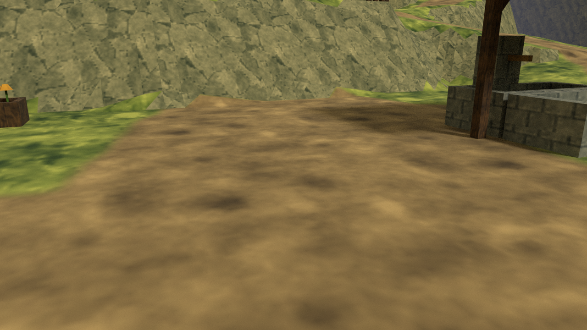
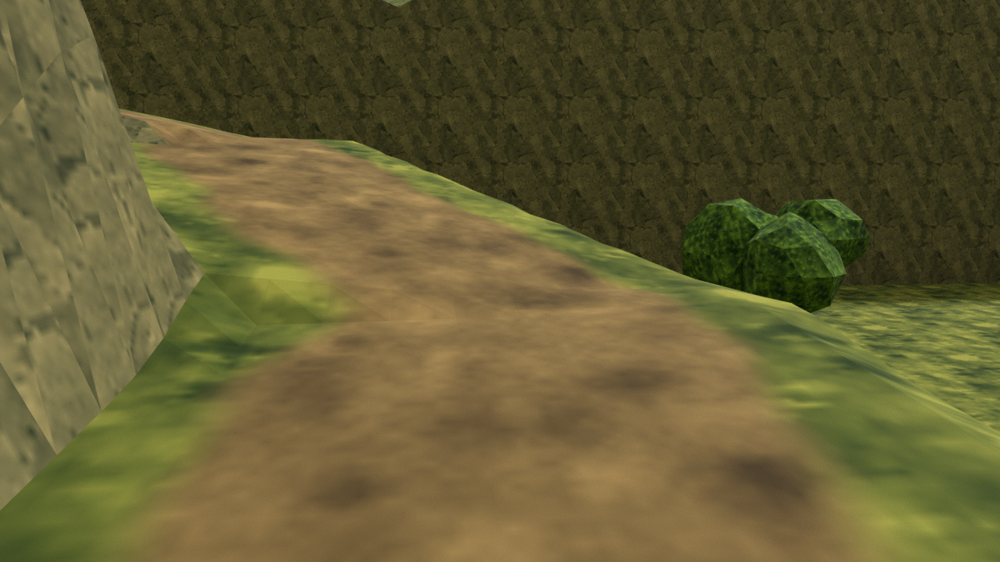
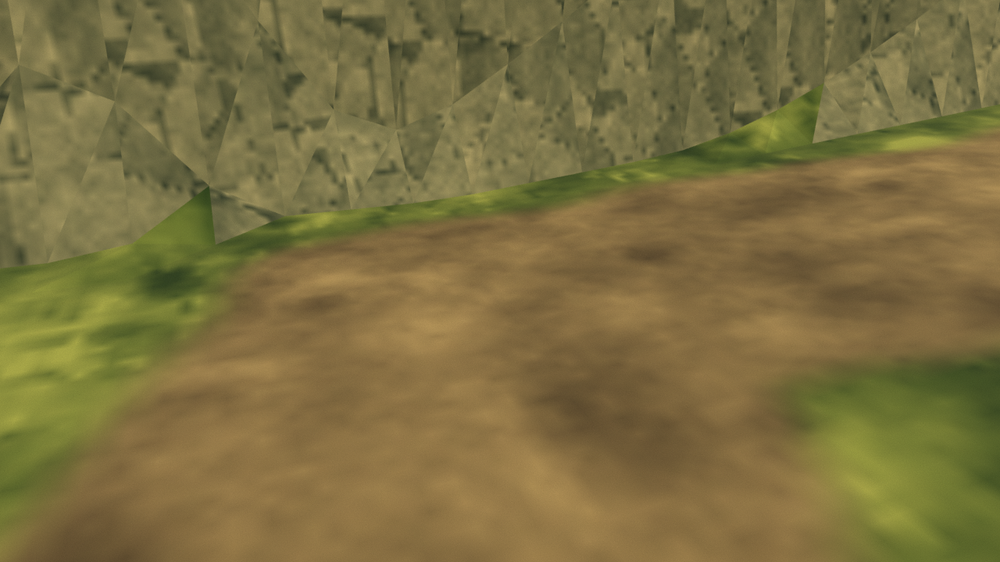

# Path overlap and cliff-projection repair

The supplied Unity screenshots exposed visual defects that the earlier support and closed-shell checks did not catch. The decorative road ribbons overlapped at junctions, folded at bends, and sampled higher neighbouring terrain at their edges. Some upper-ramp faces floated nearly one metre above the ground. Valid collision underneath did not make those visible surfaces correct.

## Changes

All seven separate road ribbons have been removed. Dirt and grass now blend on the **same opaque landform triangles**, using one united mask. Crossings share one surface and one UV orientation, so there are no competing depth layers or road edges that can form upright dirt curtains. The original 64×64 surface tiles repeat every 4 m. The 1024×1024 grayscale image only places the materials; it is not a replacement high-resolution surface texture.

The new mask revealed another problem: higher terrace geometry invaded the upper ramp's width. The roadbed now cuts into high ground and fills low ground across its full **4.5 m width**, then blends into surrounding banks. Dirt coverage excludes steep faces and points whose height disagrees with the intended road level. The middle path starts on its flat stair landing. The bell approach and four steps now enter the pavilion from the east, away from the cut bank.

The material is implemented in `Assets/Resources/VillageGround.shader`, with matching Blender nodes. Its layout mask is `Assets/Resources/VillageMasks/GroundPaths.png`. The source and Unity use the same world-XY UV transform. The plain OBJ/MTL has a grass fallback; its blended ground requires the bundled Unity shader or the `.blend` material. The export-reimport preview reconstructs that material from the actual external PNG files.

## Views and checks

These are actual Blender source-scene renders, not Unity captures or exact matches of the user's camera positions.







The [new path checker](village-path-checks.json) passes:

- Zero remaining detached path meshes and zero overlapping ground triangle pairs.
- 4,456 projected top triangles checked for overlap in the path region.
- 2,085 samples covering 0.65 m of walking width along every authored path, with full dirt coverage.
- 50,810 painted pixels form one connected network; no dirt renders on steep cliff faces.
- All three problem junctions are continuous and the ground UV error is zero.

The full ground, perimeter, foundation and prop checks also pass after the roadbed change. C# syntax and the exported files pass their checks. Unity shader compilation, actual player traversal and Quest performance remain untested in this cloud environment.

The [ROM study](oot-rom-study.md) records the directly measured scene and material findings behind the modeling rules. Shared geometric boundaries and compact tiled materials were useful lessons; the original game's open render boundaries are not copied into the VR environment.

```sh
blender -b -t 8 --python-exit-code 1 --python Tools/create_village.py -- --no-render
python3 Tools/check_village_export.py
blender -b -t 4 --python-exit-code 1 --python Tools/check_village_paths.py
blender -b -t 4 --python-exit-code 1 --python Tools/check_village_integrity.py
blender -b -t 4 --python-exit-code 1 --python Tools/check_village_placements.py
blender -b -t 4 --python-exit-code 1 --python Tools/check_village_roundtrip.py
blender -b -t 8 --python-exit-code 1 --python Tools/render_village_reviews.py
```
