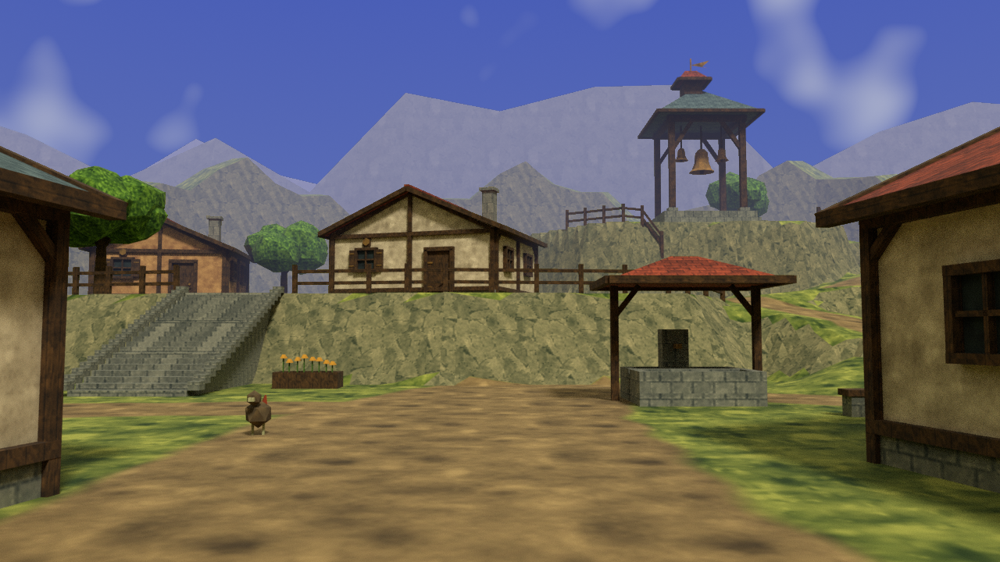

# Mossbell Village: completed scenery and geometry repairs

Mossbell keeps its original 64×64 textured village style, six varied workshops, seven green tree shapes, the three-bell pavilion and covered twin spring. This pass completes the buildings and replaces disconnected ground/cliff pieces that left narrow cavities. The original reference pack informed material scale and composition; these assets use original artwork and geometry.

## What changed

- **Continuous terrain:** one watertight landform joins the court, terraces and both hill climbs. There are no separate ramp/terrace shells to leave internal cracks. Dirt is blended into that same surface, with a united coverage mask and full-width cut/fill roadbeds. There are no separate path planes.
- **Continuous perimeter:** a shared wall mesh replaces the detached rock blocks. Its bottoms overlap the ground, and explicit final triangles are shared with collision. The southern entrance remains open.
- **Completed cottages:** all six now have closed wall-and-attic cores overlapping thick roof slabs, finished roof undersides, ridge caps, capped chimneys, rear and side windows, timber courses, braces, shutters and door hardware. These remain solid exterior buildings.
- **Grounded placement:** foundations are checked across their whole footprints; fence-post bottoms are fitted to all four ground corners. Planters and the hilltop fence no longer obstruct routes. Cart wheels and bird feet meet the ground. Solid bench/cart bases and basin water collision close small hiding pockets.
- **Accessible pavilion:** four 17.5 cm closed steps meet its floor on the east side, clear of the upper road cut and terrace fence.
- **Runtime protection:** physical horizontal headset movement sweeps the character capsule against walls. Head penetration covers the view until the player retreats. Leaving the village boundary or falling beneath its ground returns the player to the entrance. Imported east/arrival/exit markers keep boundary coordinates correct even if the model importer mirrors an axis.

Textures retain separate grass, foliage, rock, masonry, plaster, timber, roof, cloth, water and metal patterns. They are softly filtered, with mipmaps. Grass and dirt share 4 m metric UV repeats and blend on the one ground mesh; a 1024×1024 linear coverage mask places the original 64×64 tiles. No package manifest changes are needed.

## Viewing and source



[Before this polish](mossbell-before-polish.png) · [Matched comparison](village-comparison.html) · [Spring](mossbell-spring.png) · [Upper terrace](mossbell-terrace.png) · [Full layout](mossbell-village.png) · [OBJ reimport](village-export-check.png)

Editable source: `Blender/MossbellVillage.blend`. Unity model: `Assets/Resources/Village/Mossbell.obj` and `.mtl`. Textures: `Assets/Resources/VillageTextures/`. Containment polygon: `Assets/Resources/VillageBoundary.json`. Collision and markers are separate invisible material groups; visible objects stay batched by material.

In Unity, open `Assets/Scenes/Meadow.unity`, press Play and **F8** for the desktop entrance view. F8 again resumes movement. **V** moves near the meadow gate at X 240, Z 104. In VR, travel through that gate normally.

## Completed checks

- **7 routes / 1,699 samples:** ground support and capsule-footprint headroom; both hill climbs remain under 17° along their checked centrelines. The separate steps are checked as stairs.
- **52,440 ground probes:** no missing floor, internal cavity crossing or visual/collision height mismatch.
- **4,080 perimeter rays and 5,406 wall-floor probes:** both sides of the wall and buried joins pass.
- **44 closed source/collision shells:** connected, positive-volume, manifold meshes with consistent winding and no zero-area faces.
- **Six complete cottage foundations / 1,563 probes:** no floating areas or burial above the footings; seven tree base rings also meet terrain.
- **Six door approaches:** 0.65 m width and 1.8 m headroom clear. Another 864 foundation perimeter samples and **82 prop/post bases** pass the placement audit.
- **Portable OBJ export:** finite geometry, indices, UV area, required groups, original 64×64 tiles, the ground coverage mask and relative texture paths pass. Reimport checks the exported files and renders a new preview.
- **Path rendering geometry:** no detached strips or overlapping top faces; 2,085 corridor samples and all three problem junctions pass. See [path repair](village-path-repair.md).
- **C# syntax parsing:** all project C# files parse; this is not Unity compilation.

Reports: [routes](village-geometry-checks.json), [whole-area integrity](village-integrity-checks.json), [placement](village-placement-checks.json), [export](village-export-checks.json).

The model contains **23,000 visible triangles in 20 material groups**, **9,926 collision triangles**, and 36 marker triangles. These are asset counts, not measured headset performance.

The images are Blender renders. Unity 2022.3.20f1 and a Quest headset are unavailable here; Unity compilation, imported collision behavior, room-scale comfort, stereo rendering and device frame timing remain unverified. Geometry sampling is extensive but cannot prove that every possible gameplay exploit is impossible.

## Unity checks still required

Run **Wizzard > Validate project** after import. In Play mode, run **Wizzard > Validate room-scale wall collision**: this exercises actual CharacterController thin-wall sweeps, unobstructed motion, rotated tracking, capsule alignment, ceiling occlusion and teleport reset. That menu check is added but has not been run here.

On Quest, traverse both hill paths, both sets of steps, every cottage and the perimeter; crouch beside bases and gently approach walls/ceilings within a safe physical play area. Confirm head occlusion releases on retreat, entry/exit works repeatedly, and exterior/under-ground recovery returns to the entrance. Check frame timing on the target headset.

## Rebuild

```sh
blender -b -t 8 --python-exit-code 1 --python Tools/create_village.py
python3 Tools/check_village_export.py
blender -b -t 4 --python-exit-code 1 --python Tools/check_village_integrity.py
blender -b -t 4 --python-exit-code 1 --python Tools/check_village_placements.py
blender -b -t 4 --python-exit-code 1 --python Tools/check_village_roundtrip.py
blender -b -t 4 --python-exit-code 1 --python Tools/check_village_paths.py
blender -b -t 8 --python-exit-code 1 --python Tools/render_village_reviews.py
```

`Tools/check_village_walls.py` forwards to the current integrity audit. Earlier separate-wall reports and previews are historical.
