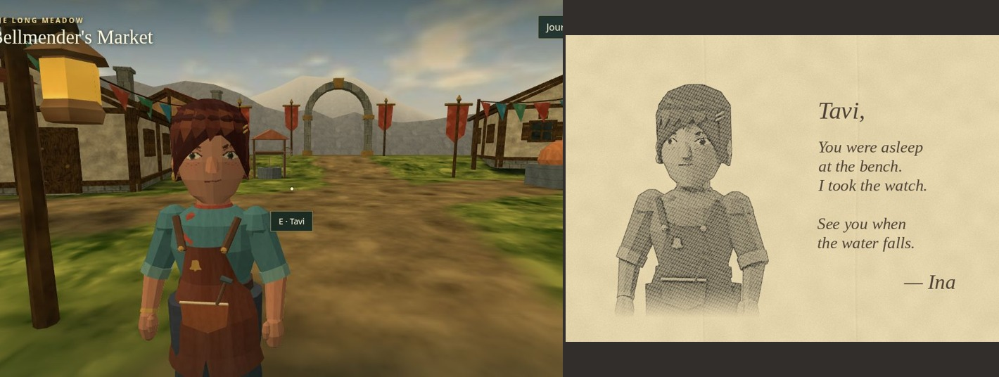
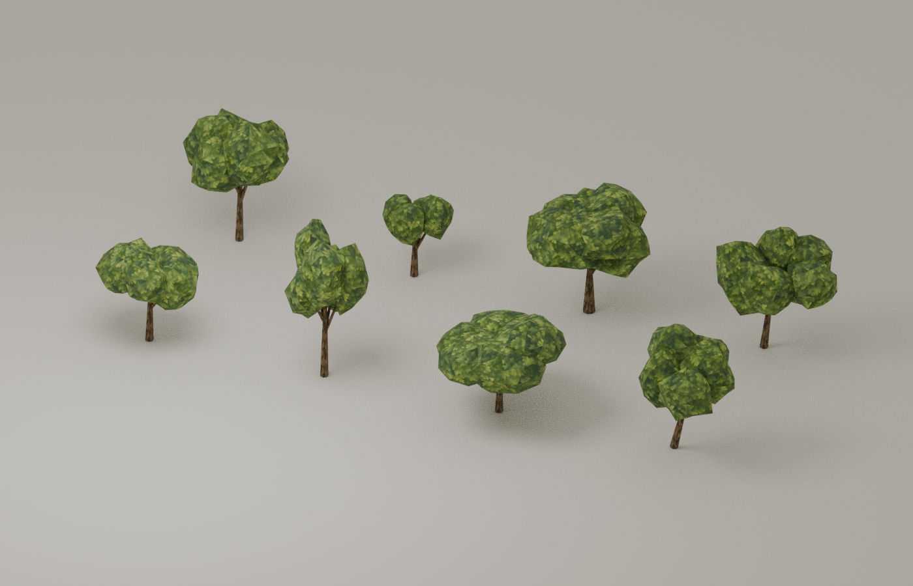
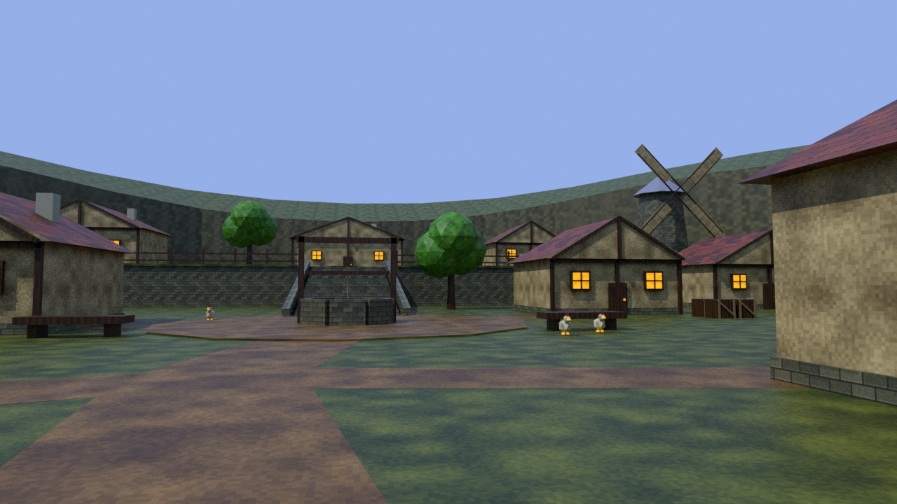

# Wizzard · Bellwake

An original, N64-inspired adventure for standalone Meta Quest and desktop. Tavi the bellmender needs your help finding the voice her sister gave to the village bell. Step through the blue door in Bellmarket and help Tavi restage the sisters’ childhood paper play. Follow Ina’s trail through thirty-three places on the main route, with an optional thirty-fourth at the harbour kitchen. Pilot the boats of Saltwake Sound and reopen the five wards of the Pilgrims’ Cut. Carry the lost mail across Rimeway. In Sillwater Parish, take six sightings across two tides and restore three lost addresses to Ada’s map. Find four missing loads in Drift Fen with Willa’s sounding fork. At Swallow Stair, work Fen’s double lock to carry four flood-night cargoes and decide how to sign Ina’s watch slip. Beyond the lock, haul singing glass through the mine. At the Glass Rookery, whistle three pilot birds home and discover what Ina sent her sister. Beneath the village, reconstruct the night of the flood through the work of three guilds. At Wrenfall Head, sight the pilots’ marks and guide the cutter Linnet through the reef. Carry her flood book through the Countertide Engine, where the dock, mould loft and signal weavers still owe the crew their last dispatch. Take the completed book to the keeper and decide the future of the bell.



**Play immediately** by opening `Play/Bellwake.html` in Chrome or Edge. Use WASD to move, drag to look, E to interact and J to open your witness book. To try Drift Fen immediately, take the red **Drift Fen** return fare to the right of the market entrance. The neighboring green counter serves Sillwater. The northeast towpath brings you back to Tavi. When hosting for Quest Browser, use `Play/index.html` and its adjacent `assets` folder to download districts as you enter them. Both editions support immersive WebXR on secure origins.

**Open in Unity** with Unity 2022.3.20f1 and choose **Wizzard → Play Bellwake**. The market sign leads to the original two-kilometre Long Meadow and its Mossbell Village gate.

[Story, controls, Quest Browser setup and editable art](Documentation/Bellwake/guide.md) · [Validation results](Documentation/Bellwake/validation.md)

## Open the Unity project (standalone Meta Quest)

1. Install **Unity 2022.3.20f1** using Unity Hub, including **Android Build Support,
   Android SDK & NDK Tools, and OpenJDK**. Add this directory as a project.
2. Let Package Manager resolve the pinned OpenXR 1.9.1, XR Management 4.4.0,
   and Input System 1.7.0 dependencies. Accept an editor restart if prompted.
3. The editor setup script configures Quest Android and PC OpenXR with controller profiles.
   You can run **Wizzard → Configure Quest and PC OpenXR** again. Run OpenXR Project
   Validation and resolve any runtime/platform-specific requirements.
4. Choose **Wizzard → Play Bellwake**, or open `Assets/Scenes/Meadow.unity` and press **Play**. The bootstrap creates the market and player at runtime.
5. In **File → Build Settings**, switch to **Android**. The setup uses ARM64,
   IL2CPP, OpenGL ES 3, linear color, single-pass stereo, Meta Quest Support,
   and Touch controller interaction profiles. Run OpenXR Project Validation for Android.
6. Run **Wizzard → Build Quest APK** to create `Builds/LongMeadow-Quest.apk`.
   Enable developer mode on your Quest and connect it by USB. Authorize USB
   debugging, then install with `adb install -r Builds/LongMeadow-Quest.apk`.
   Launch **Wizzard Bellwake** from the headset's Unknown Sources library.
   This creates a development/sideload build; store submission is not configured.
7. Optional: for PC Play mode through Quest Link, switch to the PC build target,
   enable Meta's PC OpenXR runtime, connect Link, and press Play.

Plant either palm against terrain, a stone, or a tree, then push/pull your arm to
move. Push down and release for a jump. Crouch physically to reach the ground.
Right stick snaps rotation 45°. Tracking uses floor space; match your runtime's
floor calibration. There is no grip-button requirement. Physical headset comfort and frame timing still need device testing.

Without a headset: **WASD** moves, **Space** jumps, **middle click** captures mouse
look, **Escape** releases it. Mouse buttons lower the corresponding debug palms;
this mode is for inspecting the map, not a faithful VR hand simulator.

## Blender artwork

Blender **4.3.2** is installed in the cloud at `/usr/bin/blender`.
`Blender/LongMeadow.blend` contains the complete landscape and example avatar.
`Assets/Resources/GorillaTorso.obj` is the exported avatar body used by Unity;
the tracked palms and arms use the new Bellwake Blender models. The first-person head is the
camera. Blender source stays outside Assets to avoid Unity's automatic Blender
conversion and its external FBX tooling requirements.

Regenerate the legacy meadow artwork and preview from the repository root.

```sh
blender -b --threads 8 --python Tools/create_art.py
blender -b Blender/LongMeadow.blend --python Tools/validate_art.py
```

## Validation status

The campaign has end-to-end browser playthroughs, emulated Quest input checks, FBX placement and collision audits, and a C# compilation check using Unity’s 2022.3.20f1 assemblies. The installed editor stopped at license activation before Play mode and APK export. Device frame timing and physical headset comfort remain open. Development APKs log the median, 95th percentile and maximum frame interval in each room.

[Read the measured results and test scope](Documentation/Bellwake/validation.md)

## Forest-style textures and future props

The legacy meadow and village surfaces use distinct original 64×64 textures
with muted colors, broad mottling, bilinear filtering and mipmaps. This approximates
the soft, low-resolution forest surfaces in the supplied reference. Texture
projection supports models without UVs, including the exported gorilla torso.

Run **Wizzard → Create retro material library** (also called by project setup).
This creates editable materials in `Assets/RetroMaterials`: Grass, Bark, Stone,
Leaves, Fur, Skin, HousePlaster, RoofTiles and Wood. Drag the appropriate material
onto each renderer/material slot of a house or prop. Adjust **Texture repeats per
unit** for the model's scale. Existing customized library materials are preserved.
New props keep their own assigned materials; there is no global grass replacement.
For custom artwork, duplicate a library material and assign your own 32×32 or
64×64 texture, using Repeat, Bilinear, mipmaps enabled and anisotropic level 0.

Runtime world materials are generated by `RetroMaterials.cs`; edit its palettes
for the generated world. The editable library is for manually placed props.
Blender artwork regeneration still produces the earlier preview palette. Unity
shader compilation, visual review and Quest performance remain untested here.

## Eight low-poly tree variants

The meadow now distributes eight original branching tree models: Round, Tall,
Wide, Leaning, Forked, Young, Old, and Asymmetric. Each gets a deterministic yaw
and 85–115% scale variation. All use the existing low-resolution bark/leaf
materials, flat crown normals and climbable mesh colliders. Geometry is shared
by instances. The trees are approximately 4–9 metres tall before instance scaling.

Models: `Assets/Resources/Trees/Tree01.obj` through `Tree08.obj`. You can also drag
these models into a scene manually; the runtime tree factory applies the retro
materials and colliders to the generated meadow instances.
Source: `Blender/TreeVariants.blend`. Regenerate with:
`blender -b --threads 8 --python Tools/create_trees.py`.



This Blender preview shows the shapes with simple face colors. Unity applies
its forest textures. Export geometry and the Blender render were checked;
Unity imports, shader compilation, collisions and Quest performance still need
validation in the editor/on device.

## Mossbell Village

An original mountain village is now reached through a gate near meadow coordinates
**X 240, Z 104**. In desktop Play mode, press **V** to move near that entrance,
then walk forward through the gate. In VR, travel to the small rocky mountain in
the meadow and pass between its gate pillars.

The camera fades to black, displays **Entering / Mossbell Village**, instantiates
the village while the screen is covered, places the player safely inside, and
fades back in. Walking back out behind the village arrival point reverses the transition.
The meadow and village are mutually enabled areas in the same scene, not an
additive scene download. The village is retained after first entry so return
visits reuse its geometry. Movement velocity and planted-hand contacts reset on
teleport; head tracking continues during the fade. A short arrival distance and
cooldown avoid immediately entering the return gate.

Mossbell has its own take on a terraced N64-era village: six varied plaster-and-timber workshops, red and slate roofs, an open three-bell pavilion on the upper hill, and a covered twin spring beside the court. Seven green tree shapes, planters, a potter's handcart, fences and small brown birds complete the setting. The artwork and landmark designs are original; no Nintendo assets or reference-image pixels are included.

Source: `Blender/MossbellVillage.blend`. Export: `Assets/Resources/Village/Mossbell.obj` and `.mtl`. The source keeps editable named objects and packed textures; export copies are batched by material. Cottages have sealed walls and attics, thick roofs with finished undersides, detailed rear/side elevations and grounded stone footings. Their interiors are solid; props are static. Original 64×64 tiles provide separate grass, dirt, natural rock, stonework, plaster, timber, roof, foliage, cloth, brass and water materials. Bilinear filtering and mipmaps preserve the texture at headset distances.



[Current refresh and validation limits](Documentation/village-refresh.md) · [Earlier rebuild history](Documentation/village-rebuild.md) · [Geometry report](Documentation/village-geometry-checks.json)

The existing scene loads the new model through the village fade transition. A single watertight landform joins the lawns and both hill climbs. Dedicated collision follows that exact ground, the continuous perimeter, stairs, sealed building shells, fences and tree trunks. Fence feet follow the final terrain; seven routes and all six cottage door approaches are checked for support and clearance. Materials use the authored UVs, soft directional shadows and blue-lavender fog. Dirt and grass now share one ground surface: intersecting roads are blended through one coverage mask, and ramps have full-width roadbeds so adjacent cliffs cannot invade them. Meadow atmosphere and movement settings restore on exit.

For a repeatable desktop comparison, play Meadow and press **F8**. It loads the village and switches to the 1.65 m entrance camera with the overlay and avatar hidden. Press F8 again to resume movement. Choose **Wizzard > Capture village comparison** to save an actual Unity capture. This review camera is disabled while XR is active.

Regenerate with:

```sh
blender -b -t 8 --python-exit-code 1 --python Tools/create_village.py
python Tools/check_village_export.py
```

Blender renders, route support/headroom checks and export integrity checks passed. The cloud editor requires license activation, and native physics, shaders and standalone headset performance still need device validation. Run **Wizzard > Validate project** after import and follow the headset checks in the handoff. This rebuild makes no package manifest change.

The village also has room-scale wall sweeps, head occlusion when physical head movement crosses solid scenery, and recovery to the entrance if the player leaves the boundary or falls beneath the ground. These runtime protections require Unity/Quest testing. In desktop Play mode, run **Wizzard > Validate room-scale wall collision** for the real Unity physics check.

See the [current geometry and placement report](Documentation/village-refresh.md), [whole-area integrity results](Documentation/village-integrity-checks.json), and [door/prop placement results](Documentation/village-placement-checks.json).

## Road overlap repair and ROM study

The flickering path junctions and stretched dirt walls have been replaced by dirt blended directly into the solid terrain. The original 64×64 grass/dirt tiles retain a shared physical scale; a separate coverage mask places the paths. The bell steps now approach from its east side, clear of the upper road cut.

[ROM study notes](Documentation/oot-rom-study.md) describe the supplied PAL1.1 data, including all file/scene headers and detailed outdoor room measurements. [Path repair checks](Documentation/village-path-checks.json) validate the actual geometry, UVs and coverage image. [Path repair details and close views](Documentation/village-path-repair.md) explain the screenshot fixes. The new shader still needs Unity/Quest validation.
