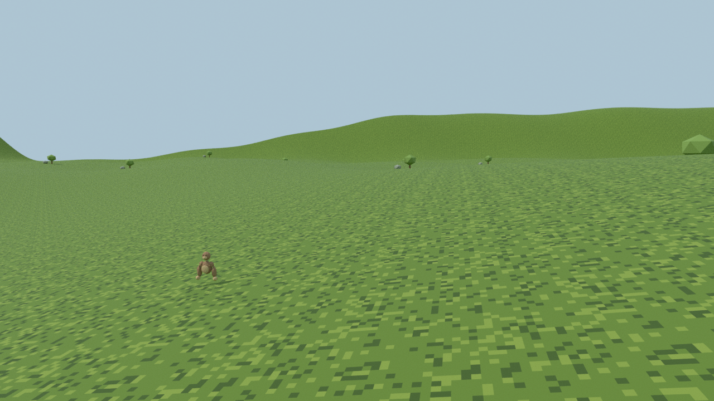
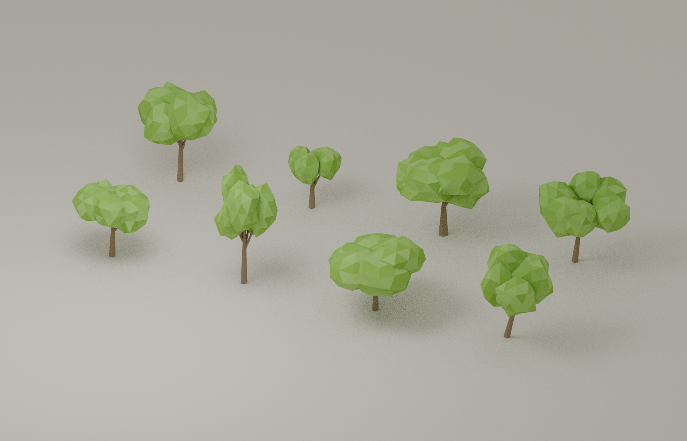
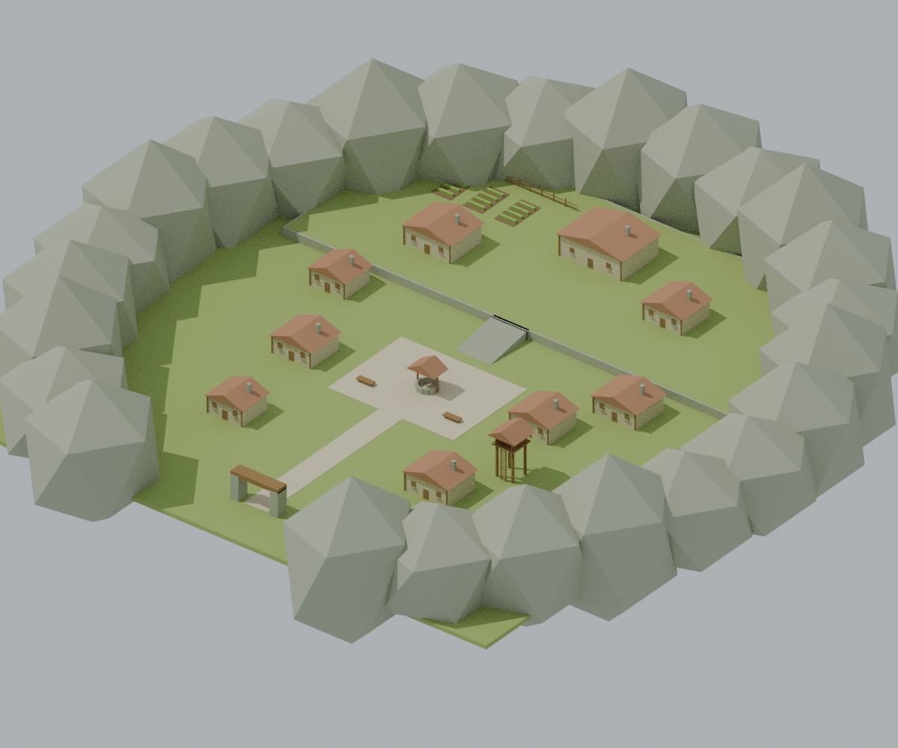

# Wizzard — The Long Meadow

An original N64-style grassy VR playground: **2,048 × 2,048 metres**, small rolling
hills, mottled 64×64 grass, 48 scattered climbable stone/tree landmarks, and a
simple brown gorilla avatar. Arm-driven locomotion is implemented from scratch;
no Gorilla Tag code or Nintendo assets are included.

The Blender preview below shows the earlier terrain layout and palette. The updated
Unity materials use darker, softly filtered forest textures; their in-game appearance
has not yet been rendered or validated here.



## Open the Unity project (standalone Meta Quest)

1. Install **Unity 2022.3.20f1** using Unity Hub, including **Android Build Support,
   Android SDK & NDK Tools, and OpenJDK**. Add this directory as a project.
2. Let Package Manager resolve the pinned OpenXR 1.9.1, XR Management 4.4.0,
   and Input System 1.7.0 dependencies. Accept an editor restart if prompted.
3. The editor setup script configures Quest Android and PC OpenXR with controller profiles.
   You can run **Wizzard → Configure Quest and PC OpenXR** again. Run OpenXR Project
   Validation and resolve any runtime/platform-specific requirements.
4. Open `Assets/Scenes/Meadow.unity` and press **Play**. The scene creates the
   terrain and player when entering Play mode; it is intentionally empty in edit mode.
5. In **File → Build Settings**, switch to **Android**. The setup uses ARM64,
   IL2CPP, OpenGL ES 3, linear color, single-pass stereo, Meta Quest Support,
   and Touch controller interaction profiles. Run OpenXR Project Validation for Android.
6. Run **Wizzard → Build Quest APK** to create `Builds/LongMeadow-Quest.apk`.
   Enable developer mode on your Quest and connect it by USB. Authorize USB
   debugging, then install with `adb install -r Builds/LongMeadow-Quest.apk`.
   Launch **The Long Meadow** from the headset's Unknown Sources library.
   This creates a development/sideload build; store submission is not configured.
7. Optional: for PC Play mode through Quest Link, switch to the PC build target,
   enable Meta's PC OpenXR runtime, connect Link, and press Play.

Plant either palm against terrain, a stone, or a tree, then push/pull your arm to
move. Push down and release for a jump. Crouch physically to reach the ground.
Right stick snaps rotation 45°. Tracking uses floor space; match your runtime's
floor calibration. There is no grip-button requirement. This is a prototype;
headset comfort, collision edge cases, and real-world controller behavior still
need play testing.

Without a headset: **WASD** moves, **Space** jumps, **middle click** captures mouse
look, **Escape** releases it. Mouse buttons lower the corresponding debug palms;
this mode is for inspecting the map, not a faithful VR hand simulator.

## Blender artwork

Blender **4.3.2** is installed in the cloud at `/usr/bin/blender`.
`Blender/LongMeadow.blend` contains the complete landscape and example avatar.
`Assets/Resources/GorillaTorso.obj` is the exported avatar body used by Unity;
the game creates tracked palms and arm segments. The first-person head is the
camera. Blender source stays outside Assets to avoid Unity's automatic Blender
conversion and its external FBX tooling requirements.

Regenerate all artwork and the Blender preview from the repository root:

```sh
blender -b --threads 8 --python Tools/create_art.py
blender -b Blender/LongMeadow.blend --python Tools/validate_art.py
```

## Validation status

- Blender asset generation and CPU preview render: **passed**.
- Blender terrain extent, triangle count, mesh indices, hills, texture size,
  and exported avatar: checked by `Tools/validate_art.py`.
- Unity editor compilation, package resolution, play mode and builds: **unrun**.
  The editor is not installed; the cloud proxy denies `download.unity3d.com`
  and `packages.unity.com`. Required network additions were saved as a draft.
- Headset locomotion, stereo rendering, performance and OpenXR runtime: **unrun**.
  No headset is attached to the cloud.

After Unity is available, run **Wizzard → Validate project**, then test in Play
mode. Check both hands on flat ground and slopes, push-off jumping, rocks/trees,
snap turns, tracking loss/recovery, room-scale head collision, and repeated Play
sessions. Inspect GC allocation and frame time on the target headset. The Quest APK build, controller tracking and performance must be validated on a
physical device once Unity and the Android toolchain are installed.

## Forest-style textures and future props

All current Unity world and avatar surfaces use distinct original 64×64 textures
with muted colors, broad mottling, bilinear filtering and mipmaps. This approximates
the soft, low-resolution forest surfaces in the supplied reference. Texture
projection supports models without UVs, including the exported gorilla torso.

Run **Wizzard → Create retro material library** (also called by project setup).
This creates editable materials in `Assets/RetroMaterials`: Grass, Bark, Stone,
Leaves, Fur, Skin, HousePlaster, RoofTiles and Wood. Drag the appropriate material
onto each renderer/material slot of a house or prop. Adjust **Texture repeats per
unit** for the model's scale. Existing customized library materials are preserved.
New props keep their own assigned materials; there is no global grass replacement.
For custom artwork, duplicate a library material and assign your own 32×32 or
64×64 texture, using Repeat, Bilinear, mipmaps enabled and anisotropic level 0.

Runtime world materials are generated by `RetroMaterials.cs`; edit its palettes
for the generated world. The editable library is for manually placed props.
Blender artwork regeneration still produces the earlier preview palette. Unity
shader compilation, visual review and Quest performance remain untested here.

## Eight low-poly tree variants

The meadow now distributes eight original branching tree models: Round, Tall,
Wide, Leaning, Forked, Young, Old, and Asymmetric. Each gets a deterministic yaw
and 85–115% scale variation. All use the existing low-resolution bark/leaf
materials, flat crown normals and climbable mesh colliders. Geometry is shared
by instances. The trees are approximately 4–9 metres tall before instance scaling.

Models: `Assets/Resources/Trees/Tree01.obj` through `Tree08.obj`. You can also drag
these models into a scene manually; the runtime tree factory applies the retro
materials and colliders to the generated meadow instances.
Source: `Blender/TreeVariants.blend`. Regenerate with:
`blender -b --threads 8 --python Tools/create_trees.py`.



This Blender preview shows the shapes with simple face colors. Unity applies
its forest textures. Export geometry and the Blender render were checked;
Unity imports, shader compilation, collisions and Quest performance still need
validation in the editor/on device.

## Mossbell Village

An original mountain village is now reached through a gate near meadow coordinates
**X 240, Z 104**. In desktop Play mode, press **V** to move near that entrance,
then walk forward through the gate. In VR, travel to the small rocky mountain in
the meadow and pass between its gate pillars.

The camera fades to black, displays **Entering / Mossbell Village**, instantiates
the village while the screen is covered, places the player safely inside, and
fades back in. Walking through the village's exit gate reverses the transition.
The meadow and village are mutually enabled areas in the same scene, not an
additive scene download. The village is retained after first entry so return
visits reuse its geometry. Movement velocity and planted-hand contacts reset on
teleport; head tracking continues during the fade. A short arrival distance and
cooldown avoid immediately entering the return gate.

The village has nine plaster cottages/hall buildings with tiled roofs, a well
square, watchtower with a climbable ladder, gardens, benches, a stepped upper
terrace and enclosing cliffs. Buildings are exterior models; their doors do not
open. Models use the existing separate low-resolution prop materials. Houses,
terrain and cliffs have static mesh collision. Village model import keeps Read/
Write enabled for Quest runtime marker lookup and collision setup. Arrival and
exit use dedicated invisible material slots, making placement independent of
OBJ coordinate conversion or Unity combining meshes.

Source: `Blender/MossbellVillage.blend`; exported geometry:
`Assets/Resources/Village/Mossbell.obj`. Regenerate from the repository root:
`blender -b --threads 8 --python Tools/create_village.py`.



The preview shows simple source colors; Unity applies the game's textures and
adds trees. Blender generation/render and OBJ index/material/marker checks passed.
C# syntax parsing passed, which does not establish Unity API or shader compilation.
Run **Wizzard > Validate project** after import. Then test entry, the black screen
and title in both eyes, arrival facing the square, walking/collision, terrace
stairs, exiting, repeat visits and tracking during fades on a physical Quest.
These Unity/device checks remain unrun in this cloud environment.

Reference research: requests to the following Kakariko reference pages were
blocked by the cloud proxy (HTTP CONNECT 403); no additional online images were
viewed or copied. This village is an original layout, not a recreation of that map.
- https://www.zeldadungeon.net/wiki/Kakariko_Village
- https://zelda.fandom.com/wiki/Kakariko_Village

The two reference-site domain additions were saved to the environment settings
draft, preserving existing Unity domains. Apply them there to unblock research;
saving the draft alone does not change current network access.
